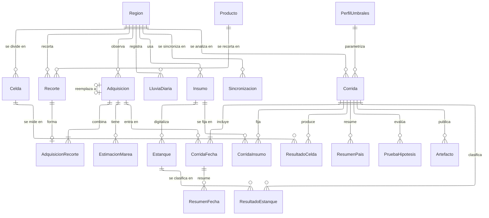

# Alcance

Detrás del mapa, el sistema es un **registro de observaciones con análisis
versionados**. Todo el modelo gira alrededor de una pregunta: qué hectáreas de
manglar dejaron de inundarse con la marea, y con qué certeza. Las regiones, los
productos, las mareas y los insumos existen para responderla; las corridas
guardan cada respuesta sin pisar la anterior.

Las cuatro fuerzas que dominan el diseño:

1. **El dato de NASA cambia debajo del sistema.**
   NISAR publica productos provisionales, luego validados, y reprocesará las
   fechas viejas con versiones de procesamiento nuevas. El modelo guarda la
   madurez y el CRID de cada producto, reemplaza sin borrar y nunca mezcla
   madurezas en una corrida.
2. **Un resultado sin su procedencia no vale.**
   Cada corrida apunta a las adquisiciones, los insumos y la versión de umbrales
   exactos que usó. Publicar otra corrida no altera la anterior, y un enlace
   compartido sigue mostrando lo mismo.
3. **Lo pesado vive en disco, lo consultable en la base.**
   Los recortes HDF5 y las grillas agregadas son archivos con su suma SHA-256.
   PostgreSQL guarda sus metadatos y los resultados por celda que la API lee.
4. **La incertidumbre es parte del dato.**
   La probabilidad de error, la confianza del cambio y la suficiencia de fechas
   de marea alta son columnas, no notas al pie. El modelo impide publicar una
   desconexión sin ellas.

## Diagrama conceptual

## Módulos

|             Módulo             |       App de Django       |                                       Contenido                                        |
| :----------------------------: | :-----------------------: | :------------------------------------------------------------------------------------: |
|      [Regiones][regiones]      |   `mangroove_regiones`    |                                   `Region`, `Celda`                                    |
| [Adquisiciones][adquisiciones] | `mangroove_adquisiciones` | `Producto`, `Recorte`, `Adquisicion`, `AdquisicionRecorte`, `Brecha`, `Sincronizacion` |
|       [Insumos][insumos]       |    `mangroove_insumos`    |        `Insumo`, `Estanque`, `SerieCargada`, `EstimacionMarea`, `LluviaDiaria`         |
|      [Análisis][analisis]      |   `mangroove_analisis`    |        `PerfilUmbrales`, `Corrida`, `CorridaFecha`, `CorridaInsumo`, resultados        |
|   [Publicación][publicacion]   |  `mangroove_publicacion`  |                                      `Artefacto`                                       |

Las cuentas, la autenticación, la bitácora y los archivos en Bunny son del
template (`api_auth`, `api_core`, `api_media`) y no se modifican.

## Restricciones del alcance

|             Restricción             |        Origen        |                          Consecuencia en el modelo                          |
| :---------------------------------: | :------------------: | :-------------------------------------------------------------------------: |
|      Solo NISAR L2 GCOV y GUNW      | [`RF-M-01`][rf-m-01] |        `Producto` no modela productos de nivel 0 ni 1, ni la banda S        |
|    Una proyección UTM por región    |   [`RN-03`][rn-03]   |          Una región que cruza dos zonas UTM usa la de su centroide          |
|       Celdas cuadradas fijas        |   [`RN-03`][rn-03]   |          No hay celdas de tamaño variable ni jerarquías de celdas           |
|  Sin interfaz gráfica de operación  | [`RF-O-01`][rf-o-01] |          Toda operación pasa por la API y los comandos de gestión           |
| Los sensores auxiliares son insumos | [`RF-C-06`][rf-c-06] | Sentinel-1 y Sentinel-2 no tienen ingesta automática; se cargan como insumo |

## Fuera de alcance

|                 Funcionalidad                 |                       Estado                        |
| :-------------------------------------------: | :-------------------------------------------------: |
|            Cuentas para el público            |   Sin requerimiento: todos los datos son abiertos   |
|      Alertas al público por correo o SMS      |         Excluido en el documento preliminar         |
|         Edición de datos por terceros         |         Excluido en el documento preliminar         |
|       Titularidad de estanques y bordas       |            Excluido por [`RN-16`][rn-16]            |
| Interferometría y deformación (GUNW completo) | Solo se usa la coherencia, por [`RF-M-09`][rf-m-09] |
|     Relato guiado y textos en dos idiomas     |            Responsabilidad del frontend             |

---

## Invariantes críticos

Garantías que no pueden fallar. Todas son estructurales: viven en la base de
datos, no en un servicio.

|                     Invariante                     |               Mecanismo                |      Regla       |
| :------------------------------------------------: | :------------------------------------: | :--------------: |
|          Una corrida no mezcla madurezas           |  `trg_corridafecha_madurez_coherente`  | [`RN-01`][rn-01] |
| Una pasada tiene a lo sumo una adquisición vigente |    `unq_adquisicion_pasada_vigente`    | [`RN-02`][rn-02] |
|         La grilla de una región no cambia          |         `trg_readonly_grilla`          | [`RN-03`][rn-03] |
|       Sin datos suficientes no hay `if_alta`       | `chk_resultadocelda_ifalta_suficiente` | [`RN-10`][rn-10] |
|        Fuera de la máscara no hay métricas         |   `chk_resultadocelda_fuera_mascara`   | [`RN-12`][rn-12] |
| Un cambio publicado trae fecha, confianza y delta  |  `chk_resultadocelda_cambio_completo`  | [`RN-13`][rn-13] |
|     Los resultados de una corrida no se editan     |     `trg_resultado_solo_insercion`     | [`RN-14`][rn-14] |
|       Una región tiene a lo sumo una vigente       |      `unq_corrida_region_vigente`      | [`RN-15`][rn-15] |

[adquisiciones]: modulos/adquisiciones.md
[analisis]: modulos/analisis.md
[insumos]: modulos/insumos.md
[publicacion]: modulos/publicacion.md
[regiones]: modulos/regiones.md
[rf-c-06]: ../requerimientos/funcionales/consulta.md#rf-c-06
[rf-m-01]: ../requerimientos/funcionales/motor.md#rf-m-01
[rf-m-09]: ../requerimientos/funcionales/motor.md#rf-m-09
[rf-o-01]: ../requerimientos/funcionales/operacion.md#rf-o-01
[rn-01]: ../requerimientos/reglas-negocio.md#rn-01
[rn-02]: ../requerimientos/reglas-negocio.md#rn-02
[rn-03]: ../requerimientos/reglas-negocio.md#rn-03
[rn-10]: ../requerimientos/reglas-negocio.md#rn-10
[rn-12]: ../requerimientos/reglas-negocio.md#rn-12
[rn-13]: ../requerimientos/reglas-negocio.md#rn-13
[rn-14]: ../requerimientos/reglas-negocio.md#rn-14
[rn-15]: ../requerimientos/reglas-negocio.md#rn-15
[rn-16]: ../requerimientos/reglas-negocio.md#rn-16
