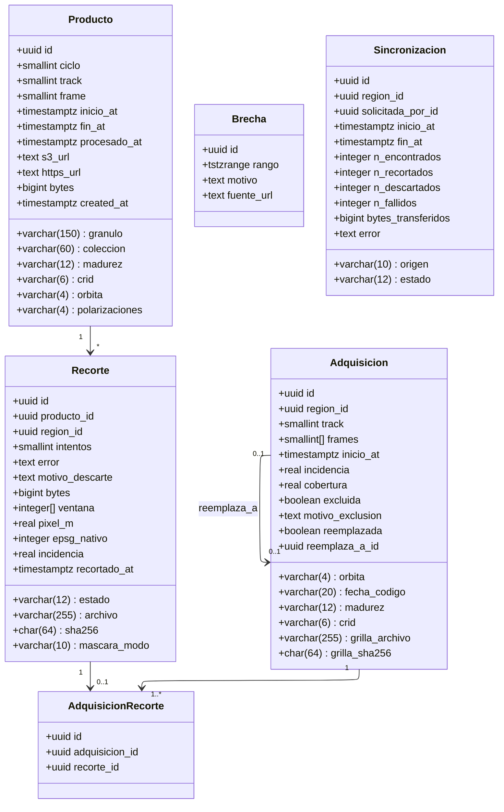

# Adquisiciones

Seis tablas en la app `mangroove_adquisiciones`: lo que NASA publicó
(`Producto`), lo que el motor leyó para cada región (`Recorte`), las pasadas
del satélite sobre cada región (`Adquisicion`), cómo se combinan, las brechas
del instrumento y el registro de cada sincronización.

La distinción entre producto, recorte y adquisición es la decisión central del
módulo. Un producto es un archivo de NASA; puede cubrir dos regiones
([`D-11`][d-11]). Un recorte es el trabajo de leer ese archivo para una región;
puede fallar. Una adquisición es una pasada del satélite sobre una región;
puede venir de dos frames, y puede ser reemplazada por un reproceso
([`RN-02`][rn-02]).

## Requerimientos cubiertos

- [`RF-M-01`][rf-m-01] a [`RF-M-06`][rf-m-06]
- [`RF-M-24`][rf-m-24]
- [`RF-O-05`][rf-o-05]
- [`RF-O-06`][rf-o-06]
- [`RF-O-08`][rf-o-08]

## Diagrama



---

## `Producto`

Un gránulo NISAR L2 GCOV tal como lo publica ASF. Sus metadatos no cambian: un
reproceso es otro gránulo.

- **Régimen:** [Solo inserción][regimenes]
- **Volumen estimado:** 100-300 filas por región y año
- **Origen:**
  > - [`RF-M-01`][rf-m-01]
  > - [`RF-M-03`][rf-m-03]

### Columnas

|         Campo         |      Tipo      | Nulo | Predeterminado |                          Descripción                          |
| :-------------------: | :------------: | :--: | :------------: | :-----------------------------------------------------------: |
|       `granulo`       | `varchar(150)` |  no  |                |          Nombre completo del gránulo, sin extensión           |
|      `coleccion`      | `varchar(60)`  |  no  |                |    Colección de ASF: `NISAR_L2_GCOV_PROVISIONAL_V1`, etc.     |
|       `madurez`       | `varchar(12)`  |  no  |                | `beta` / `provisional` / `validado`, deducida de la colección |
|        `crid`         |  `varchar(6)`  |  no  |                |        Versión de procesamiento: `P05023`, `P05036`...        |
|        `ciclo`        |   `smallint`   |  no  |                |                       Ciclo de 12 días                        |
|        `track`        |   `smallint`   |  no  |                |               Track relativo (`033`, `098`...)                |
|        `frame`        |   `smallint`   |  no  |                |                                                               |
|       `orbita`        |  `varchar(4)`  |  no  |                |                        `asc` / `desc`                         |
| `inicio_at`, `fin_at` | `timestamptz`  |  no  |                |              `zeroDopplerStartTime` y `EndTime`               |
|    `procesado_at`     | `timestamptz`  |  sí  |                |      Fecha de procesamiento según ASF; nulo si no la da       |
|   `polarizaciones`    |  `varchar(4)`  |  no  |                |                       `DHDH`, `SHNA`...                       |
|       `s3_url`        |     `text`     |  no  |      `''`      |                 `''` = ASF no publicó ruta S3                 |
|      `https_url`      |     `text`     |  no  |                |                                                               |
|        `bytes`        |    `bigint`    |  sí  |                |          Tamaño del `.h5`; nulo si ASF no lo informa          |

### Constraints

```postgresql
CONSTRAINT chk_producto_crid
CHECK (crid ~ '^P[0-9]{5}$')

CONSTRAINT chk_producto_madurez
CHECK (madurez IN ('beta', 'provisional', 'validado'))

CONSTRAINT chk_producto_orbita
CHECK (orbita IN ('asc', 'desc'))

CONSTRAINT chk_producto_tiempo
CHECK (fin_at > inicio_at)
```

### Unicidad e índices

|         Nombre         |             Definición              |               Propósito                |
| :--------------------: | :---------------------------------: | :------------------------------------: |
| `unq_producto_granulo` |             `(granulo)`             |    Una búsqueda repetida no duplica    |
| `idx_producto_pasada`  | `(track, frame, orbita, inicio_at)` | Encontrar versiones de la misma pasada |

---

## `Recorte`

El trabajo de leer un producto para una región, y su resultado en disco.

- **Régimen:** [Mutable rastreada][regimenes]
- **Volumen estimado:** igual a `Producto` por región
- **Origen:**
  > - [`RF-M-02`][rf-m-02]
  > - [`RF-M-24`][rf-m-24]

### Columnas

|       Campo       |      Tipo      | Nulo | Predeterminado |                        Descripción                         |
| :---------------: | :------------: | :--: | :------------: | :--------------------------------------------------------: |
|   `producto_id`   |     `uuid`     |  no  |                |                                                            |
|    `region_id`    |     `uuid`     |  no  |                |                                                            |
|     `estado`      | `varchar(12)`  |  no  | `'pendiente'`  |    `pendiente` / `recortado` / `descartado` / `fallido`    |
|    `intentos`     |   `smallint`   |  no  |      `0`       |                    Lecturas intentadas                     |
|      `error`      |     `text`     |  no  |      `''`      |                Último error; `''` = ninguno                |
| `motivo_descarte` |     `text`     |  no  |      `''`      |  Por qué no se usará: CRID viejo, sin HV, fuera del área   |
|     `archivo`     | `varchar(255)` |  no  |      `''`      |      Ruta relativa del HDF5; `''` mientras no exista       |
|     `sha256`      |   `char(64)`   |  sí  |                |                                                            |
|      `bytes`      |    `bigint`    |  sí  |                |                                                            |
|     `ventana`     |  `integer[]`   |  no  |     `'{}'`     |        Filas y columnas leídas: `{r0, r1, c0, c1}`         |
|     `pixel_m`     |     `real`     |  sí  |                |               Espaciado nativo del producto                |
|   `epsg_nativo`   |   `integer`    |  sí  |                |               EPSG de la grilla del producto               |
|   `incidencia`    |     `real`     |  sí  |                |   Ángulo de incidencia medio sobre la región, en grados    |
|  `mascara_modo`   | `varchar(10)`  |  no  |  `'estricta'`  | `estricta` (máscara 1-254) / `relleno` (solo descarta 255) |
|  `recortado_at`   | `timestamptz`  |  sí  |                |                                                            |

### Constraints

```postgresql
CONSTRAINT chk_recorte_estado
CHECK (estado IN ('pendiente', 'recortado', 'descartado', 'fallido'))

CONSTRAINT chk_recorte_recortado_completo
CHECK (
  (estado = 'recortado') = (
    archivo <> '' AND sha256 IS NOT NULL AND recortado_at IS NOT NULL
    AND cardinality(ventana) = 4
  )
)

CONSTRAINT chk_recorte_descarte_motivo
CHECK ((estado = 'descartado') = (motivo_descarte <> ''))

CONSTRAINT chk_recorte_intentos
CHECK (intentos BETWEEN 0 AND 3)
```

### Unicidad e índices

|            Nombre             |                               Definición                                |               Propósito               |
| :---------------------------: | :---------------------------------------------------------------------: | :-----------------------------------: |
| `unq_recorte_producto_region` |                       `(producto_id, region_id)`                        | Un producto se lee una vez por región |
|   `idx_recorte_pendientes`    | `(region_id) WHERE estado IN ('pendiente', 'fallido') AND intentos < 3` |  Cola de la siguiente sincronización  |

### Triggers

|             Nombre              |       Evento       | Momento  | Nivel |                                       Regla                                        |        Origen        |
| :-----------------------------: | :----------------: | :------: | :---: | :--------------------------------------------------------------------------------: | :------------------: |
| `trg_recorte_transicion_valida` | `UPDATE OF estado` | `BEFORE` | `ROW` | `pendiente` y `fallido` pasan a cualquiera; `recortado` y `descartado` son finales | [`RF-M-24`][rf-m-24] |

---

## `Adquisicion`

Una pasada del satélite sobre una región, formada por uno o dos recortes.

- **Régimen:** [Mutable rastreada][regimenes]
- **Volumen estimado:** 80-120 filas por región y año
- **Origen:**
  > - [`RF-M-04`][rf-m-04]
  > - [`RF-M-05`][rf-m-05]
  > - [`RF-M-06`][rf-m-06]
  > - [`RF-O-06`][rf-o-06]

### Columnas

|       Campo        |      Tipo      | Nulo | Predeterminado |                           Descripción                           |
| :----------------: | :------------: | :--: | :------------: | :-------------------------------------------------------------: |
|    `region_id`     |     `uuid`     |  no  |                |                                                                 |
|      `track`       |   `smallint`   |  no  |                |                                                                 |
|      `orbita`      |  `varchar(4)`  |  no  |                |                         `asc` / `desc`                          |
|      `frames`      |  `smallint[]`  |  no  |                |                   Frames combinados, en orden                   |
|    `inicio_at`     | `timestamptz`  |  no  |                |              Inicio del primer frame de la pasada               |
|   `fecha_codigo`   | `varchar(20)`  |  no  |    derivada    |    `AAAA-MM-DD_TTT_orbita` en fecha UTC; lo fija el trigger     |
|     `madurez`      | `varchar(12)`  |  no  |                |                    Copiada de sus productos                     |
|       `crid`       |  `varchar(6)`  |  no  |                |                    Copiado de sus productos                     |
|    `incidencia`    |     `real`     |  sí  |                |               Promedio ponderado de sus recortes                |
|    `cobertura`     |     `real`     |  no  |                |      Fracción de celdas de la región con muestras válidas       |
|  `grilla_archivo`  | `varchar(255)` |  no  |      `''`      |  `.npy` con HH y HV agregados a la grilla; `''` = sin agregar   |
|  `grilla_sha256`   |   `char(64)`   |  sí  |                |                                                                 |
|     `excluida`     |   `boolean`    |  no  |    `false`     |                    Excluida por el operador                     |
| `motivo_exclusion` |     `text`     |  no  |      `''`      |                                                                 |
|   `reemplazada`    |   `boolean`    |  no  |    `false`     |   Un reproceso la reemplazó; la fija el trigger del reemplazo   |
|  `reemplaza_a_id`  |     `uuid`     |  sí  |                | Adquisición anterior de la misma pasada; nulo = primera versión |

Una adquisición es **vigente** cuando no fue reemplazada y no está excluida.
El puntero va de la versión nueva a la vieja porque el reemplazo ocurre al
insertar la nueva: en ese instante la vieja ya existe y la nueva todavía no.
Solo las vigentes entran a corridas nuevas.

### Constraints

```postgresql
CONSTRAINT chk_adquisicion_cobertura
CHECK (cobertura BETWEEN 0 AND 1)

CONSTRAINT chk_adquisicion_exclusion_motivo
CHECK (excluida = (motivo_exclusion <> ''))

CONSTRAINT chk_adquisicion_grilla_completa
CHECK ((grilla_archivo <> '') = (grilla_sha256 IS NOT NULL))

CONSTRAINT chk_adquisicion_no_se_reemplaza_a_si_misma
CHECK (reemplaza_a_id IS DISTINCT FROM id)
```

### Unicidad e índices

|              Nombre              |                                               Definición                                               |               Propósito               |
| :------------------------------: | :----------------------------------------------------------------------------------------------------: | :-----------------------------------: |
| `unq_adquisicion_pasada_vigente` | `(region_id, track, orbita, date_trunc('minute', inicio_at AT TIME ZONE 'UTC')) WHERE NOT reemplazada` |           [`RN-02`][rn-02]            |
|  `unq_adquisicion_region_fecha`  |                           `(region_id, fecha_codigo) WHERE NOT reemplazada`                            |       Un `fecha_id` por pasada        |
|   `unq_adquisicion_reemplazaa`   |                                           `(reemplaza_a_id)`                                           | Una versión se reemplaza una sola vez |
|    `idx_adquisicion_vigentes`    |                `(region_id, madurez, inicio_at) WHERE NOT reemplazada AND NOT excluida`                |    Elegir fechas para una corrida     |

### Triggers

|               Nombre                |                                 Evento                                 | Momento  | Nivel |                                                                                      Regla                                                                                       |      Origen      |
| :---------------------------------: | :--------------------------------------------------------------------: | :------: | :---: | :------------------------------------------------------------------------------------------------------------------------------------------------------------------------------: | :--------------: |
|  `trg_adquisicion_derivar_codigo`   |                                `INSERT`                                | `BEFORE` | `ROW` |                                                      Sobrescribe `fecha_codigo` desde `inicio_at` (UTC), `track` y `orbita`                                                      | [`RN-18`][rn-18] |
|     `trg_readonly_adquisicion`      | `UPDATE OF region_id, track, orbita, inicio_at, madurez, crid, frames` | `BEFORE` | `ROW` |                                                                       La identidad de la pasada no cambia                                                                        | [`RN-02`][rn-02] |
| `trg_adquisicion_aplicar_reemplazo` |                                `INSERT`                                | `BEFORE` | `ROW` | Si trae `reemplaza_a_id`, exige misma región y pasada, CRID mayor y la anterior todavía no reemplazada, y marca la anterior `reemplazada` antes de que se evalúe el índice único | [`RN-02`][rn-02] |
|      `trg_readonly_reemplazo`       |                `UPDATE OF reemplazada, reemplaza_a_id`                 | `BEFORE` | `ROW` |                                    `reemplazada` solo pasa de falso a verdadero y solo desde el trigger anterior; `reemplaza_a_id` no cambia                                     | [`RN-02`][rn-02] |

---

## `AdquisicionRecorte`

Qué recortes forman cada adquisición. Una pasada que cae en dos frames tiene
dos filas.

- **Régimen:** [Solo inserción][regimenes]
- **Volumen estimado:** 1-2 filas por adquisición
- **Origen:** [`RF-M-04`][rf-m-04]

### Unicidad y triggers

|              Nombre              |                      Definición                       |
| :------------------------------: | :---------------------------------------------------: |
| `unq_adquisicionrecorte_recorte` | `(recorte_id)`: un recorte forma una sola adquisición |

`trg_adquisicionrecorte_coherente` (`BEFORE INSERT`) exige que el recorte esté
`recortado`, sea de la misma región, del mismo track, órbita y CRID, y que su
inicio esté a menos de dos minutos del de la adquisición.

---

## `Brecha`

Un período sin datos del instrumento. Es global: una brecha de NISAR afecta a
todas las regiones.

- **Régimen:** [Mutable rastreada][regimenes]
- **Volumen estimado:** decenas de filas
- **Origen:** [`RN-17`][rn-17]

|    Campo     |    Tipo     | Nulo | Predeterminado |           Descripción            |
| :----------: | :---------: | :--: | :------------: | :------------------------------: |
|   `rango`    | `tstzrange` |  no  |                |  Semiabierto: `[desde, hasta)`   |
|   `motivo`   |   `text`    |  no  |                | Descripción de NASA o del equipo |
| `fuente_url` |   `text`    |  no  |      `''`      |    Enlace al aviso de origen     |

```postgresql
CONSTRAINT excl_brecha_rango
EXCLUDE USING gist (rango WITH &&)
```

La primera migración la siembra con la brecha permanente del 27 de julio de 2026
a las 22:03:25 UTC al 10 de agosto de 2026 a las 00:55:27 UTC, publicada en la
guía de usuario de NISAR.

---

## `Sincronizacion`

Cada ejecución de la ingesta sobre una región.

- **Régimen:** [Mutable rastreada][regimenes]
- **Volumen estimado:** 4 filas por región y día
- **Origen:**
  > - [`RF-M-24`][rf-m-24]
  > - [`RF-O-08`][rf-o-08]

|             Campo              |     Tipo      |  Nulo   | Predeterminado |                 Descripción                 |
| :----------------------------: | :-----------: | :-----: | :------------: | :-----------------------------------------: |
|          `region_id`           |    `uuid`     |   no    |                |                                             |
|            `origen`            | `varchar(10)` |   no    |                |           `programada` / `manual`           |
|      `solicitada_por_id`       |    `uuid`     |   sí    |                | Cuenta que la pidió; nulo si fue programada |
|            `estado`            | `varchar(12)` |   no    |  `'en_curso'`  |    `en_curso` / `completada` / `fallida`    |
|     `inicio_at`, `fin_at`      | `timestamptz` | no / sí |    `now()`     |                                             |
| `n_encontrados` a `n_fallidos` |   `integer`   |   no    |      `0`       |            Conteos de productos             |
|      `bytes_transferidos`      |   `bigint`    |   no    |      `0`       |                                             |
|            `error`             |    `text`     |   no    |      `''`      |  Error que detuvo el lote; `''` = ninguno   |

```postgresql
CONSTRAINT chk_sincronizacion_origen
CHECK ((origen = 'manual') = (solicitada_por_id IS NOT NULL))

CONSTRAINT chk_sincronizacion_cierre
CHECK ((estado = 'en_curso') = (fin_at IS NULL))
```

|                Nombre                |               Definición                |               Propósito                |
| :----------------------------------: | :-------------------------------------: | :------------------------------------: |
| `unq_sincronizacion_region_en_curso` | `(region_id) WHERE estado = 'en_curso'` | Una sincronización a la vez por región |

[d-11]: ../decisiones.md#d-11
[regimenes]: ../convenciones.md#regimenes-de-escritura
[rf-m-01]: ../../requerimientos/funcionales/motor.md#rf-m-01
[rf-m-02]: ../../requerimientos/funcionales/motor.md#rf-m-02
[rf-m-03]: ../../requerimientos/funcionales/motor.md#rf-m-03
[rf-m-04]: ../../requerimientos/funcionales/motor.md#rf-m-04
[rf-m-05]: ../../requerimientos/funcionales/motor.md#rf-m-05
[rf-m-06]: ../../requerimientos/funcionales/motor.md#rf-m-06
[rf-m-24]: ../../requerimientos/funcionales/motor.md#rf-m-24
[rf-o-05]: ../../requerimientos/funcionales/operacion.md#rf-o-05
[rf-o-06]: ../../requerimientos/funcionales/operacion.md#rf-o-06
[rf-o-08]: ../../requerimientos/funcionales/operacion.md#rf-o-08
[rn-02]: ../../requerimientos/reglas-negocio.md#rn-02
[rn-17]: ../../requerimientos/reglas-negocio.md#rn-17
[rn-18]: ../../requerimientos/reglas-negocio.md#rn-18
