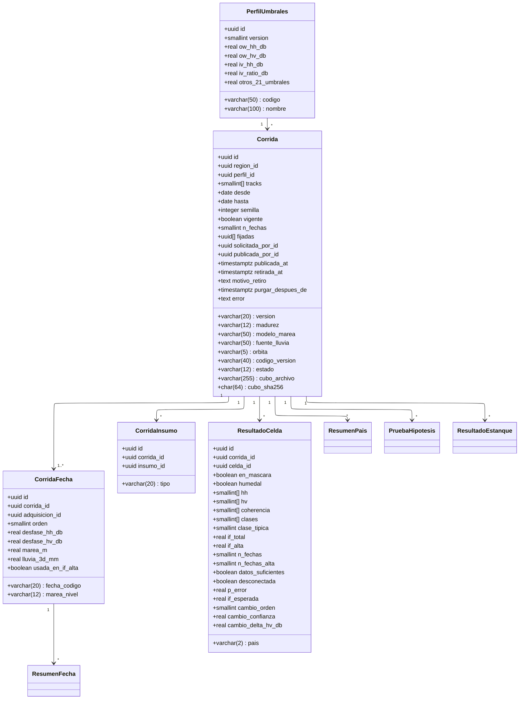

# Análisis

Nueve tablas en la app `mangroove_analisis`: los perfiles de umbrales, la
corrida con sus fechas e insumos fijados, y los resultados que la API publica.

La corrida es la unidad de verdad del sistema. Todo lo que un visitante ve
pertenece a exactamente una corrida, y una corrida pertenece a exactamente una
región, una madurez y una versión de perfil. Los resultados se escriben una vez,
al terminar el cálculo, y no se tocan más ([`RN-14`][rn-14]).

## Requerimientos cubiertos

- [`RF-M-10`][rf-m-10] a [`RF-M-18`][rf-m-18]
- [`RF-M-23`][rf-m-23]
- [`RF-O-09`][rf-o-09] a [`RF-O-13`][rf-o-13]
- [`RF-C-07`][rf-c-07]
- [`RF-C-09`][rf-c-09] a [`RF-C-12`][rf-c-12]

## Diagrama



---

## `PerfilUmbrales`

Una versión de un conjunto con nombre de todos los umbrales del método. Editar
un perfil es crear su versión siguiente.

- **Régimen:** [Solo inserción][regimenes]
- **Volumen estimado:** decenas de filas
- **Origen:** [`RF-O-09`][rf-o-09]

### Columnas

Los valores predeterminados son los del perfil `predeterminado` versión 1,
tomados del método de la sección 6.4 del manual de NISAR y ajustados con la
escena sintética de prueba.

|         Campo          |      Tipo      | Predeterminado |                    Descripción                    |
| :--------------------: | :------------: | :------------: | :-----------------------------------------------: |
|        `codigo`        | `varchar(50)`  |                |   `estricto`, `predeterminado`, `permisivo`...    |
|       `version`        |   `smallint`   |    derivada    |        Siguiente versión del mismo código         |
|        `nombre`        | `varchar(100)` |                |                                                   |
| `ow_hh_db`, `ow_hv_db` |     `real`     | `-16.5`, `-22` | Agua abierta: HH y HV por debajo de estos valores |
|       `iv_hh_db`       |     `real`     |     `-6.5`     | Vegetación inundada: HH por encima de este valor  |

\1
| `iv_ratio_holgura_db` | `real` | `1.5` | Tolerancia de HH − HV al pasar de no inundado a vegetación inundada por cambio |
| `cambio_hh_db`, `cambio_hv_db` | `real` | `3`, `1.5` | Cambio respecto al promedio del track que mueve una celda de clase |
| `nc_hh_db`, `nc_hv_db` | `real` | `-1`, `-7` | Por encima: fuera del modelo (`NC`) |
| `usar_coherencia` | `boolean` | `true` | Corregir `OW` a `NI` si la coherencia es alta |
| `coherencia_min` | `real` | `0.40` | |
| `marea_alta_m` | `real` | `0.55` | Desde esta altura, la fecha es de marea alta |
| `marea_baja_m` | `real` | `-0.55` | Hasta esta altura, la fecha es de marea baja |
| `lluvia_max_mm` | `real` | `60` | Lluvia de tres días desde la que una fecha no cuenta para `if_alta` |
| `if_alta_desconectada` | `real` | `0.20` | Bajo este `if_alta`, desconectada |
| `min_fechas_alta` | `smallint` | `3` | Fechas de marea alta mínimas, por [`RN-10`][rn-10] |
| `mayoria` | `boolean` | `true` | Voto de mayoría 3 × 3 sobre la desconexión |
| `usar_elevacion` | `boolean` | `false` | Exigir inundación esperada por cota, si hay modelo de elevación |
\1
| `marea_margen_m` | `real` | `0.05` | Margen sobre la cota para contar una marea como inundante |
| `humedal_pendiente_max` | `real` | `8` | Pendiente máxima del humedal, en grados |
| `humedal_cota_max` | `real` | `15` | Cota máxima del humedal, en metros |
| `estables_minimas` | `integer` | `200` | Celdas estables mínimas para calibrar, por [`RF-M-10`][rf-m-10] |
| `sigma_db` | `real` | `0.9` | Ruido de speckle para `p_error` |
| `cusum_b` | `smallint` | `120` | Permutaciones del bootstrap |
| `cusum_confianza` | `real` | `0.95` | Confianza mínima de un cambio publicado |
| `cusum_perdida_db` | `real` | `1.5` | Caída mínima de HV de un cambio publicado |
| `cv_estanque` | `real` | `0.45` | Desde este CV, el estanque es activo |
\1
| `puntaje_distancia`, `puntaje_area`, `puntaje_inundacion` | `real` | `0.4`, `0.3`, `0.3` | Pesos del puntaje de restauración de un estanque abandonado |
| `creado_por_id` | `uuid` | | Nulo en los perfiles sembrados por migración |

Ningún campo es nulo salvo `creado_por_id`.

`usar_elevacion` es falso por defecto porque el modelo de elevación disponible
para la región, Copernicus GLO-30, es un modelo de superficie: sobre el manglar
mide la altura de la copa y no la del suelo. Con él, la inundación esperada por
cota sería casi nula en todas partes. Un perfil puede activarlo cuando se cargue
un modelo de terreno desnudo.

### Constraints

```postgresql
CONSTRAINT chk_perfilumbrales_mareas
CHECK (marea_baja_m < marea_alta_m)

CONSTRAINT chk_perfilumbrales_fracciones
CHECK (
  coherencia_min BETWEEN 0 AND 1 AND if_alta_desconectada BETWEEN 0 AND 1
  AND if_esperada_min BETWEEN 0 AND 1 AND cusum_confianza BETWEEN 0 AND 1
)

CONSTRAINT chk_perfilumbrales_cusum
CHECK (cusum_b BETWEEN 20 AND 1000 AND cusum_perdida_db > 0)

CONSTRAINT chk_perfilumbrales_clases
CHECK (ow_hh_db < iv_hh_db AND sigma_db > 0 AND min_fechas_alta >= 1)
```

|               Nombre                |     Definición      |
| :---------------------------------: | :-----------------: |
| `unq_perfilumbrales_codigo_version` | `(codigo, version)` |

Los mismos rangos, más amplios que estos `CHECK`, acotan los umbrales que acepta
una exploración pública ([`RF-C-12`][rf-c-12]).

---

## `Corrida`

Un análisis de una región con una madurez, un perfil y un conjunto de fechas e
insumos fijados.

- **Régimen:** [Mutable rastreada][regimenes]
- **Volumen estimado:** decenas por región y año
- **Origen:**
  > - [`RF-O-10`][rf-o-10] a [`RF-O-13`][rf-o-13]
  > - [`RN-01`][rn-01], [`RN-14`][rn-14], [`RN-15`][rn-15]

### Columnas

|      Campo       |     Tipo      | Nulo | Predeterminado |                                   Descripción                                    |
| :--------------: | :-----------: | :--: | :------------: | :------------------------------------------------------------------------------: |
|   `region_id`    |    `uuid`     |  no  |                |                                                                                  |
|    `version`     | `varchar(20)` |  no  |                |                    Semver de los datos, por [`RN-15`][rn-15]                     |
|   `perfil_id`    |    `uuid`     |  no  |                |                            Versión exacta del perfil                             |
|    `madurez`     | `varchar(12)` |  no  |                |                   Única madurez admitida, por [`RN-01`][rn-01]                   |
|  `modelo_marea`  | `varchar(50)` |  no  |                |                        Modelo de `EstimacionMarea` a usar                        |
| `fuente_lluvia`  | `varchar(50)` |  no  |      `''`      |                   Fuente de `LluviaDiaria`; `''` = sin lluvia                    |
|     `orbita`     | `varchar(5)`  |  no  |   `'ambas'`    |                             `ambas` / `asc` / `desc`                             |
|     `tracks`     | `smallint[]`  |  no  |     `'{}'`     |                            `'{}'` = todos los tracks                             |
| `desde`, `hasta` |    `date`     |  sí  |                |                      Rango de fechas UTC; nulo = sin límite                      |
| `codigo_version` | `varchar(40)` |  no  |                |                     Commit del código que ejecutó el cálculo                     |
|    `semilla`     |   `integer`   |  no  |    `12345`     |                    Semilla del bootstrap, por [`D-14`][d-14]                     |
|     `estado`     | `varchar(12)` |  no  | `'pendiente'`  | `pendiente` / `en_proceso` / `completada` / `fallida` / `publicada` / `retirada` |
|    `vigente`     |   `boolean`   |  no  |    `false`     |                          La publicada que ve el público                          |

\1
| `fijadas` | `uuid[]` | no | `'{}'` | Adquisiciones fijadas al crear la corrida, en orden temporal |
| `cubo_archivo` | `varchar(255)` | no | `''` | Cubo de la corrida para las exploraciones, por [`D-07`][d-07]; `''` = purgado |
| `cubo_sha256` | `char(64)` | no | `''` | |
| `solicitada_por_id` | `uuid` | sí | | Cuenta que la lanzó; nulo si la encoló una sincronización |
| `publicada_por_id` | `uuid` | sí | | Cuenta que la publicó; firma los `ApiMedia` de sus artefactos |
| `iniciada_at`, `terminada_at` | `timestamptz` | sí | | |
| `publicada_at` | `timestamptz` | sí | | |
| `retirada_at` | `timestamptz` | sí | | |
| `motivo_retiro` | `text` | no | `''` | |
| `purgar_despues_de` | `timestamptz` | sí | | `retirada_at` + 30 días |
| `error` | `text` | no | `''` | Motivo de la falla; `''` = ninguna |

### Constraints

```postgresql
CONSTRAINT chk_corrida_version
CHECK (version ~ '^\d+\.\d+\.\d+$')

CONSTRAINT chk_corrida_estado
CHECK (estado IN ('pendiente', 'en_proceso', 'completada', 'fallida', 'publicada', 'retirada'))

CONSTRAINT chk_corrida_madurez
CHECK (madurez IN ('provisional', 'validado'))

CONSTRAINT chk_corrida_vigente_publicada
CHECK (NOT vigente OR estado = 'publicada')

CONSTRAINT chk_corrida_publicacion
CHECK ((estado IN ('publicada', 'retirada')) = (publicada_at IS NOT NULL AND publicada_por_id IS NOT NULL))

CONSTRAINT chk_corrida_retiro
CHECK ((estado = 'retirada') = (retirada_at IS NOT NULL AND motivo_retiro <> '' AND purgar_despues_de IS NOT NULL))

CONSTRAINT chk_corrida_falla
CHECK ((estado = 'fallida') = (error <> ''))

CONSTRAINT chk_corrida_nfechas
CHECK (n_fechas >= 1 AND cardinality(fijadas) = n_fechas)
```

`beta` no está entre las madurezas admitidas: los productos beta no están
calibrados y la guía de NISAR desaconseja usarlos para análisis.

### Unicidad e índices

|            Nombre            |                   Definición                    |       Propósito        |
| :--------------------------: | :---------------------------------------------: | :--------------------: |
| `unq_corrida_region_version` |             `(region_id, version)`              |    [`RN-15`][rn-15]    |
| `unq_corrida_region_vigente` |           `(region_id) WHERE vigente`           | Una vigente por región |
|      `idx_corrida_cola`      |    `(created_at) WHERE estado = 'pendiente'`    |  Cola del trabajador   |
|     `idx_corrida_purga`      | `(purgar_despues_de) WHERE estado = 'retirada'` |  Barrido de la purga   |

### Triggers

|              Nombre               |                                                                  Evento                                                                   | Momento  | Nivel |                                                Regla                                                |        Origen        |
| :-------------------------------: | :---------------------------------------------------------------------------------------------------------------------------------------: | :------: | :---: | :-------------------------------------------------------------------------------------------------: | :------------------: |
|  `trg_corrida_transicion_valida`  |                                                            `UPDATE OF estado`                                                             | `BEFORE` | `ROW` | `pendiente → en_proceso → completada \| fallida`; `completada → publicada`; `publicada → retirada`  |   [`RN-14`][rn-14]   |
|      `trg_readonly_corrida`       | `UPDATE OF region_id, version, perfil_id, madurez, modelo_marea, fuente_lluvia, orbita, tracks, desde, hasta, semilla, n_fechas, fijadas` | `BEFORE` | `ROW` |                        Lo que define la corrida no cambia después de crearla                        |   [`RN-14`][rn-14]   |
|    `trg_corrida_unica_vigente`    |                                                            `UPDATE OF vigente`                                                            | `BEFORE` | `ROW` |                      Al marcar una vigente, desmarca la anterior de la región                       | [`RF-O-12`][rf-o-12] |
|   `trg_corrida_relevo_vigente`    |                                                            `UPDATE OF estado`                                                             | `AFTER`  | `ROW` |             Al retirar la vigente, marca vigente la publicada más reciente de la región             | [`RF-O-13`][rf-o-13] |
| `trg_corrida_retiro_deja_vigente` |                                                            `UPDATE OF estado`                                                             | `BEFORE` | `ROW` | Rechaza retirar la vigente si no hay otra publicada en la región, salvo que la región esté inactiva | [`RF-O-13`][rf-o-13] |

---

## `CorridaFecha`

Una adquisición dentro de una corrida, con lo que de ella depende del perfil:
desfase, nivel de marea y si cuenta para `if_alta`. Es la entrada `fechas` del
manifiesto.

- **Régimen:** [Resultado de corrida][regimenes]
- **Volumen estimado:** `n_fechas` por corrida
- **Origen:**
  > - [`RF-M-07`][rf-m-07]
  > - [`RF-M-10`][rf-m-10]
  > - [`RN-08`][rn-08], [`RN-09`][rn-09]

|              Campo               |     Tipo      | Nulo | Predeterminado |                              Descripción                               |
| :------------------------------: | :-----------: | :--: | :------------: | :--------------------------------------------------------------------: |
|           `corrida_id`           |    `uuid`     |  no  |                |                                                                        |
|         `adquisicion_id`         |    `uuid`     |  no  |                |                                                                        |
|             `orden`              |  `smallint`   |  no  |                | Posición en las series de `ResultadoCelda`, desde 0, en orden temporal |
|          `fecha_codigo`          | `varchar(20)` |  no  |    copiada     |         Copia de la adquisición; es el `fecha_id` del contrato         |
| `desfase_hh_db`, `desfase_hv_db` |    `real`     |  no  |                |  Calibración relativa restada a cada banda, por [`RF-M-10`][rf-m-10]   |
|            `marea_m`             |    `real`     |  sí  |                |            Del modelo de la corrida; nulo = sin estimación             |
|          `marea_nivel`           | `varchar(12)` |  no  |                |    `alta` / `media` / `baja` / `desconocida`, por [`RN-08`][rn-08]     |
|          `lluvia_3d_mm`          |    `real`     |  sí  |                |                 Nulo si falta alguno de los tres días                  |
|        `usada_en_if_alta`        |   `boolean`   |  no  |                |        Marea alta y lluvia bajo el umbral, por [`RN-09`][rn-09]        |

```postgresql
CONSTRAINT chk_corridafecha_nivel
CHECK ((marea_m IS NULL) = (marea_nivel = 'desconocida'))

CONSTRAINT chk_corridafecha_if_alta
CHECK (NOT usada_en_if_alta OR marea_nivel = 'alta')
```

|                 Nombre                 |           Definición           |
| :------------------------------------: | :----------------------------: |
|    `unq_corridafecha_corrida_orden`    |     `(corrida_id, orden)`      |
| `unq_corridafecha_corrida_adquisicion` | `(corrida_id, adquisicion_id)` |

|                Nombre                |       Evento       | Momento  | Nivel |                                                                        Regla                                                                         |               Origen               |
| :----------------------------------: | :----------------: | :------: | :---: | :--------------------------------------------------------------------------------------------------------------------------------------------------: | :--------------------------------: |
| `trg_corridafecha_madurez_coherente` |      `INSERT`      | `BEFORE` | `ROW` | La adquisición es de la región y de la madurez de la corrida, y no está reemplazada ni excluida; sobrescribe `fecha_codigo` con el de la adquisición | [`RN-01`][rn-01], [`RN-18`][rn-18] |
|    `trg_resultado_solo_insercion`    | `UPDATE`, `DELETE` | `BEFORE` | `ROW` |                                         Rechaza toda actualización; admite el borrado solo durante la purga                                          |          [`RN-14`][rn-14]          |

---

## `CorridaInsumo`

Qué versión de cada tipo de insumo usó la corrida.

- **Régimen:** [Resultado de corrida][regimenes]
- **Origen:** [`RF-M-23`][rf-m-23]

|               Nombre               |        Definición         |
| :--------------------------------: | :-----------------------: |
| `unq_corridainsumo_corrida_insumo` | `(corrida_id, insumo_id)` |
|  `unq_corridainsumo_corrida_tipo`  |   `(corrida_id, tipo)`    |

`trg_corridainsumo_coherente` (`BEFORE INSERT`) exige que el insumo sea de la
región de la corrida y sobrescribe `tipo` con el del insumo, de modo que el
índice único impide fijar dos insumos del mismo tipo.

---

## `ResultadoCelda`

Todo lo que la corrida sabe de una celda: su serie, sus clases y sus métricas.
Es la fila que lee el inspector.

- **Régimen:** [Resultado de corrida][regimenes]
- **Volumen estimado:** igual a las celdas de la región, por corrida
- **Origen:**
  > - [`RF-M-11`][rf-m-11] a [`RF-M-15`][rf-m-15]
  > - [`RF-C-07`][rf-c-07]

### Columnas

|            Campo            |     Tipo     | Nulo | Predeterminado |                              Descripción                              |
| :-------------------------: | :----------: | :--: | :------------: | :-------------------------------------------------------------------: |
|        `corrida_id`         |    `uuid`    |  no  |                |                                                                       |
|         `celda_id`          |    `uuid`    |  no  |                |                                                                       |
|           `pais`            | `varchar(2)` |  no  |      `''`      |                Del insumo `paises`; `''` = sin asignar                |
|        `en_mascara`         |  `boolean`   |  no  |                |                    Dentro de la máscara de manglar                    |
|          `humedal`          |  `boolean`   |  no  |                | Dentro del humedal: cota y pendiente bajas, fuera de zonas excluidas  |
|         `hh`, `hv`          | `smallint[]` |  no  |                |        dB × 100 calibrados, uno por fecha; `-32768` = sin dato        |
|        `coherencia`         | `smallint[]` |  no  |     `'{}'`     |    × 1000, uno por fecha; `'{}'` = la corrida no tiene coherencia     |
|          `clases`           | `smallint[]` |  no  |                |                    Códigos de clase, uno por fecha                    |
|       `clase_tipica`        |  `smallint`  |  no  |                |                   Clase del promedio multitemporal                    |
|         `if_total`          |    `real`    |  sí  |                |              `if` del contrato; nulo fuera de la máscara              |
|          `if_alta`          |    `real`    |  sí  |                |           Nulo fuera de la máscara o sin datos suficientes            |
| `n_fechas`, `n_fechas_alta` |  `smallint`  |  no  |                |                  Fechas que respaldan cada fracción                   |
|     `datos_suficientes`     |  `boolean`   |  no  |                |                         Por [`RN-10`][rn-10]                          |
|       `desconectada`        |  `boolean`   |  no  |                |           Por [`RN-11`][rn-11], después del voto de mayoría           |
|          `p_error`          |    `real`    |  sí  |                |                       Nulo fuera de la máscara                        |
|        `if_esperada`        |    `real`    |  sí  |                |   Inundación esperada por cota; nulo sin DEM o fuera de la máscara    |
|       `cambio_orden`        |  `smallint`  |  sí  |                |   `orden` de la primera fecha después del cambio; nulo = sin cambio   |
|     `cambio_confianza`      |    `real`    |  sí  |                |                                                                       |
|    `cambio_delta_hv_db`     |    `real`    |  sí  |                |                     HV medio después menos antes                      |
|       `perdida_copa`        |  `boolean`   |  no  |    generada    | **Almacenada**. `cambio_orden IS NOT NULL AND cambio_delta_hv_db < 0` |

`if` es palabra reservada en Python; la columna se llama `if_total` y la API la
publica como `if`.

### Constraints

```postgresql
CONSTRAINT chk_resultadocelda_series_alineadas
CHECK (
  cardinality(hh) = cardinality(hv) AND cardinality(hh) = cardinality(clases)
  AND (cardinality(coherencia) = 0 OR cardinality(coherencia) = cardinality(hh))
)

CONSTRAINT chk_resultadocelda_clases
CHECK (clases <@ ARRAY[0, 1, 2, 3, 4]::smallint[] AND clase_tipica BETWEEN 0 AND 4)

CONSTRAINT chk_resultadocelda_fracciones
CHECK (
  (if_total IS NULL OR if_total BETWEEN 0 AND 1)
  AND (if_alta IS NULL OR if_alta BETWEEN 0 AND 1)
  AND (p_error IS NULL OR p_error BETWEEN 0 AND 1)
  AND (if_esperada IS NULL OR if_esperada BETWEEN 0 AND 1)
  AND (cambio_confianza IS NULL OR cambio_confianza BETWEEN 0 AND 1)
)

CONSTRAINT chk_resultadocelda_fuera_mascara
CHECK (
  en_mascara OR (
    if_total IS NULL AND if_alta IS NULL AND p_error IS NULL
    AND if_esperada IS NULL AND cambio_orden IS NULL
    AND NOT desconectada AND NOT datos_suficientes
  )
)

CONSTRAINT chk_resultadocelda_mascara_metricas
CHECK (NOT en_mascara OR (if_total IS NOT NULL AND p_error IS NOT NULL))

CONSTRAINT chk_resultadocelda_ifalta_suficiente
CHECK (datos_suficientes = (if_alta IS NOT NULL))

CONSTRAINT chk_resultadocelda_desconexion
CHECK (NOT desconectada OR (en_mascara AND datos_suficientes))

CONSTRAINT chk_resultadocelda_cambio_completo
CHECK (
  (cambio_orden IS NULL) = (cambio_confianza IS NULL)
  AND (cambio_orden IS NULL) = (cambio_delta_hv_db IS NULL)
)
```

`chk_resultadocelda_desconexion` no exige `if_alta` bajo el umbral: después del
voto de mayoría, una celda puede quedar desconectada por sus vecinas con un
`if_alta` algo mayor. Lo que sí garantiza es que nunca se declare desconectada
una celda sin máscara o sin datos.

### Unicidad

|               Nombre               |        Definición        |                       Propósito                        |
| :--------------------------------: | :----------------------: | :----------------------------------------------------: |
| `unq_resultadocelda_corrida_celda` | `(corrida_id, celda_id)` | Lectura de una celda por llave, por [`RNF-02`][rnf-02] |

### Triggers

|              Nombre              |       Evento       | Momento  | Nivel |                                      Regla                                       |      Origen      |
| :------------------------------: | :----------------: | :------: | :---: | :------------------------------------------------------------------------------: | :--------------: |
| `trg_resultadocelda_largo_serie` |      `INSERT`      | `BEFORE` | `ROW` | El largo de las series es el `n_fechas` de la corrida y la celda es de su región |  [`D-04`][d-04]  |
|  `trg_resultado_solo_insercion`  | `UPDATE`, `DELETE` | `BEFORE` | `ROW` |                           Igual que en `CorridaFecha`                            | [`RN-14`][rn-14] |

---

## Resúmenes y pruebas

Cuatro tablas pequeñas, todas en régimen de [resultado de corrida][regimenes],
que la API sirve sin recalcular.

### `ResumenPais`

Una fila por país y una con `pais = ''` para la región completa.

|                          Campo                          |   Tipo    |                  Descripción                  |
| :-----------------------------------------------------: | :-------: | :-------------------------------------------: |
|                  `corrida_id`, `pais`                   |           | Únicos juntos: `unq_resumenpais_corrida_pais` |
|                      `ha_manglar`                       |  `real`   |               Celdas en máscara               |
| `ha_desconectada`, `ha_insuficiente`, `ha_perdida_copa` |  `real`   |                                               |
|     `ha_iv_tipica`, `ha_ow_tipica`, `ha_ni_tipica`      |  `real`   |               Por clase típica                |
|                       `n_celdas`                        | `integer` |                                               |

### `ResumenFecha`

Hectáreas de cada clase por fecha y país, para la línea de tiempo y el CSV.

|                    Campo                    |  Tipo  |                     Descripción                     |
| :-----------------------------------------: | :----: | :-------------------------------------------------: |
|                `corrida_id`                 |        |              La corrida, para la purga              |
|         `corrida_fecha_id`, `pais`          |        | Únicos juntos: `unq_resumenfecha_corridafecha_pais` |
| `ha_iv`, `ha_ow`, `ha_ni`, `ha_nc`, `ha_nd` | `real` |          Solo celdas en máscara de manglar          |

### `PruebaHipotesis`

|               Campo                |      Tipo      | Nulo |                                               Descripción                                                |
| :--------------------------------: | :------------: | :--: | :------------------------------------------------------------------------------------------------------: |
|       `corrida_id`, `codigo`       |                |  no  |                                    `H1` / `H2` / `H3`; únicos juntos                                     |
|        `grupo_a`, `grupo_b`        | `varchar(100)` |  no  |                              Descripción de cada grupo: «junto a bordas»...                              |
|              `prueba`              | `varchar(12)`  |  no  |                                 `mann_whitney` (H1, H3) / `fisher` (H2)                                  |
|            `evaluable`             |   `boolean`    |  no  |                                                                                                          |
|              `motivo`              |     `text`     |  no  |                                 Por qué no fue evaluable; `''` si lo fue                                 |
|            `n_a`, `n_b`            |   `integer`    |  no  |                                                                                                          |
|      `mediana_a`, `mediana_b`      |     `real`     |  sí  |                       Medianas en Mann-Whitney; proporciones con pérdida en Fisher                       |
| `estadistico`, `p_valor`, `efecto` |     `real`     |  sí  | U y r en Mann-Whitney; razón de momios y diferencia de proporciones en Fisher; nulos si no fue evaluable |
|                `z`                 |     `real`     |  sí  |                                           Solo en Mann-Whitney                                           |

```postgresql
CONSTRAINT chk_pruebahipotesis_evaluable
CHECK (evaluable = (p_valor IS NOT NULL) AND evaluable = (motivo = ''))
```

### `ResultadoEstanque`

|            Campo            |   Tipo    | Nulo |                         Descripción                          |
| :-------------------------: | :-------: | :--: | :----------------------------------------------------------: |
| `corrida_id`, `estanque_id` |           |  no  |                        Únicos juntos                         |
|   `cv_hh`, `cv_hv`, `cv`    |  `real`   |  no  | CV por banda, promedio de los tracks; `cv` según `cv_banda`  |
|          `activo`           | `boolean` |  no  |                     `cv >= cv_estanque`                      |
|       `dist_canal_km`       |  `real`   |  no  |              Al agua abierta típica más cercana              |
|         `if_vecino`         |  `real`   |  sí  | `if` medio del manglar a tres celdas; nulo si no hay manglar |
|          `puntaje`          |  `real`   |  sí  |                     Solo en abandonados                      |

```postgresql
CONSTRAINT chk_resultadoestanque_puntaje
CHECK (activo = (puntaje IS NULL))
```

[d-04]: ../decisiones.md#d-04
[d-07]: ../decisiones.md#d-07
[d-14]: ../decisiones.md#d-14
[regimenes]: ../convenciones.md#regimenes-de-escritura
[rf-c-07]: ../../requerimientos/funcionales/consulta.md#rf-c-07
[rf-c-09]: ../../requerimientos/funcionales/consulta.md#rf-c-09
[rf-c-12]: ../../requerimientos/funcionales/consulta.md#rf-c-12
[rf-m-07]: ../../requerimientos/funcionales/motor.md#rf-m-07
[rf-m-10]: ../../requerimientos/funcionales/motor.md#rf-m-10
[rf-m-11]: ../../requerimientos/funcionales/motor.md#rf-m-11
[rf-m-15]: ../../requerimientos/funcionales/motor.md#rf-m-15
[rf-m-18]: ../../requerimientos/funcionales/motor.md#rf-m-18
[rf-m-23]: ../../requerimientos/funcionales/motor.md#rf-m-23
[rf-o-09]: ../../requerimientos/funcionales/operacion.md#rf-o-09
[rf-o-10]: ../../requerimientos/funcionales/operacion.md#rf-o-10
[rf-o-12]: ../../requerimientos/funcionales/operacion.md#rf-o-12
[rf-o-13]: ../../requerimientos/funcionales/operacion.md#rf-o-13
[rn-01]: ../../requerimientos/reglas-negocio.md#rn-01
[rn-08]: ../../requerimientos/reglas-negocio.md#rn-08
[rn-09]: ../../requerimientos/reglas-negocio.md#rn-09
[rn-10]: ../../requerimientos/reglas-negocio.md#rn-10
[rn-11]: ../../requerimientos/reglas-negocio.md#rn-11
[rn-14]: ../../requerimientos/reglas-negocio.md#rn-14
[rn-15]: ../../requerimientos/reglas-negocio.md#rn-15
[rn-18]: ../../requerimientos/reglas-negocio.md#rn-18
[rnf-02]: ../../requerimientos/no-funcionales.md#rnf-02
