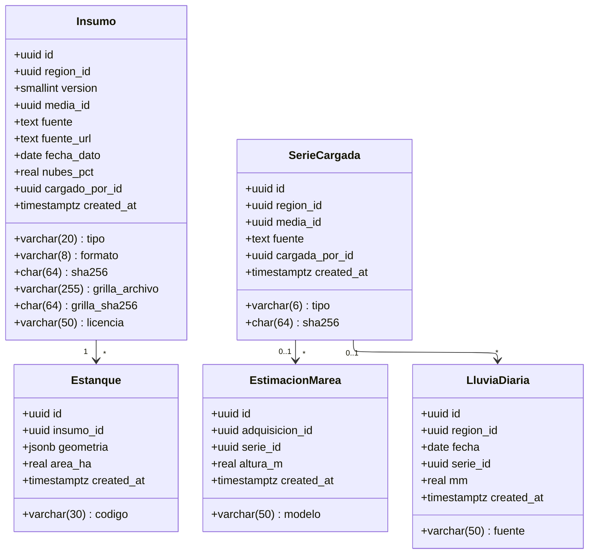

# Insumos

Cinco tablas en la app `mangroove_insumos`: las capas auxiliares de cada región
con sus versiones, los estanques digitalizados, las series cargadas a mano, la
marea por adquisición y la lluvia diaria.

Todo lo que entra al análisis sin ser radar vive aquí, y todo es de solo
inserción: un insumo nuevo es una versión nueva, nunca una corrección de la
anterior ([`D-10`][d-10]).

## Requerimientos cubiertos

- [`RF-M-07`][rf-m-07]
- [`RF-M-08`][rf-m-08]
- [`RF-O-04`][rf-o-04]
- [`RF-O-07`][rf-o-07]
- [`RF-C-06`][rf-c-06]

## Diagrama



---

## `Insumo`

Una versión de una capa auxiliar de una región, con el archivo original y su
versión rasterizada a la grilla.

- **Régimen:** [Solo inserción][regimenes]
- **Volumen estimado:** 10-50 filas por región
- **Origen:**
  > - [`RF-O-04`][rf-o-04]
  > - [`RF-C-06`][rf-c-06]

### Columnas

|      Campo       |      Tipo      | Nulo | Predeterminado |                         Descripción                          |
| :--------------: | :------------: | :--: | :------------: | :----------------------------------------------------------: |
|   `region_id`    |     `uuid`     |  no  |                |                                                              |
|      `tipo`      | `varchar(20)`  |  no  |                |                Ver la tabla de tipos de abajo                |
|    `version`     |   `smallint`   |  no  |    derivada    |           Siguiente versión del tipo en la región            |
|    `formato`     |  `varchar(8)`  |  no  |                |                     `raster` / `vector`                      |
|    `media_id`    |     `uuid`     |  no  |                | Archivo original en Bunny, privado (`ApiMedia` del template) |
|     `sha256`     |   `char(64)`   |  no  |                |                  Suma del archivo original                   |
| `grilla_archivo` | `varchar(255)` |  no  |                |   `.npy` del insumo rasterizado o reproyectado a la grilla   |
| `grilla_sha256`  |   `char(64)`   |  no  |                |                                                              |
|     `fuente`     |     `text`     |  no  |                |    Cita de la fuente: «Global Mangrove Watch v3.0 (2020)»    |
|   `fuente_url`   |     `text`     |  no  |      `''`      |                                                              |
|    `licencia`    | `varchar(50)`  |  no  |                |                `CC-BY-4.0`, `ODbL-1.0`, etc.                 |
|   `fecha_dato`   |     `date`     |  sí  |                |       Fecha de la escena; solo en `optico` y `banda_c`       |
|   `nubes_pct`    |     `real`     |  sí  |                |            Porcentaje de nubes; solo en `optico`             |
| `cargado_por_id` |     `uuid`     |  no  |                |               Cuenta de operación que lo subió               |

### Tipos de insumo

|        Tipo        |       Formato admitido       |               Rasterizado a la grilla como               |               Uso                |
| :----------------: | :--------------------------: | :------------------------------------------------------: | :------------------------------: |
|     `manglar`      |      GeoTIFF o GeoJSON       |  `uint8`: 1 si la fracción de manglar en la celda ≥ 0,5  |  Máscara, por [`RN-12`][rn-12]   |
|    `elevacion`     |           GeoTIFF            |        `float32`: cota media en m, `NaN` sin dato        | Humedal, inundación esperada, H1 |
|    `exclusion`     |           GeoJSON            |              `uint8`: 1 = fuera del humedal              |        Máscara de humedal        |
|     `barreras`     | GeoJSON con propiedad `tipo` |              `uint8`: 1 = borda, 2 = camino              |              H1, H2              |
|    `estanques`     |           GeoJSON            | `int32`: número de estanque; además, filas en `Estanque` |                H3                |
|      `paises`      | GeoJSON con propiedad `iso`  |           `uint8`: índice del país en la celda           |          País por celda          |
| `areas_protegidas` |           GeoJSON            |          Sin rasterizar; se publica como vector          |            Mapa base             |
|      `optico`      |           GeoTIFF            |       RGB reproyectado a la extensión de la región       |      Comparador de sensores      |
|     `banda_c`      |           GeoTIFF            |          VV y VH en dB a la grilla de la región          |      Comparador de sensores      |

### Constraints

```postgresql
CONSTRAINT chk_insumo_tipo
CHECK (tipo IN ('manglar', 'elevacion', 'exclusion', 'barreras', 'estanques',
                'paises', 'areas_protegidas', 'optico', 'banda_c'))

CONSTRAINT chk_insumo_escena
CHECK ((tipo IN ('optico', 'banda_c')) = (fecha_dato IS NOT NULL))

CONSTRAINT chk_insumo_nubes
CHECK ((nubes_pct IS NULL OR tipo = 'optico') AND (nubes_pct IS NULL OR nubes_pct BETWEEN 0 AND 100))
```

### Unicidad

|              Nombre              |          Definición          |                  Propósito                  |
| :------------------------------: | :--------------------------: | :-----------------------------------------: |
| `unq_insumo_region_tipo_version` | `(region_id, tipo, version)` |                                             |
| `unq_insumo_region_tipo_sha256`  | `(region_id, tipo, sha256)`  | Subir el mismo archivo no crea otra versión |

### Triggers

|            Nombre            |  Evento  | Momento  | Nivel |                                            Regla                                             |     Origen     |
| :--------------------------: | :------: | :------: | :---: | :------------------------------------------------------------------------------------------: | :------------: |
| `trg_insumo_derivar_version` | `INSERT` | `BEFORE` | `ROW` | Sobrescribe `version` con la máxima del tipo en la región más uno, bajo candado de la región | [`D-10`][d-10] |

---

## `Estanque`

Un polígono de estanque de una versión del insumo `estanques`. Existe como fila,
además de rasterizado, porque la API lo lista, lo ordena y devuelve su polígono.

- **Régimen:** [Solo inserción][regimenes]
- **Volumen estimado:** cientos por versión
- **Origen:** [`RF-M-16`][rf-m-16]

|    Campo    |     Tipo      | Nulo | Predeterminado |                        Descripción                         |
| :---------: | :-----------: | :--: | :------------: | :--------------------------------------------------------: |
| `insumo_id` |    `uuid`     |  no  |                |               Versión del insumo `estanques`               |
|  `codigo`   | `varchar(30)` |  no  |                | Propiedad `id` del GeoJSON, o el número asignado al cargar |
| `geometria` |    `jsonb`    |  no  |                |                Polígono GeoJSON en lon/lat                 |
|  `area_ha`  |    `real`     |  no  |                |             Área en la proyección de la región             |

|            Nombre            |      Definición       |
| :--------------------------: | :-------------------: |
| `unq_estanque_insumo_codigo` | `(insumo_id, codigo)` |

`trg_estanque_insumo_tipo` (`BEFORE INSERT`) exige que el insumo sea de tipo
`estanques`. El modelo no tiene columnas de propietario ni de concesión, por
[`RN-16`][rn-16].

---

## `SerieCargada`

Un CSV de marea o de lluvia subido por el operador. Se guarda el archivo para
que la corrida que lo usó sea reproducible.

- **Régimen:** [Solo inserción][regimenes]
- **Volumen estimado:** pocas filas por región
- **Origen:** [`RF-O-07`][rf-o-07]

|      Campo       |     Tipo     | Nulo | Predeterminado |               Descripción                |
| :--------------: | :----------: | :--: | :------------: | :--------------------------------------: |
|   `region_id`    |    `uuid`    |  no  |                |                                          |
|      `tipo`      | `varchar(6)` |  no  |                |            `marea` / `lluvia`            |
|    `media_id`    |    `uuid`    |  no  |                |      CSV original, privado en Bunny      |
|     `sha256`     |  `char(64)`  |  no  |                |                                          |
|     `fuente`     |    `text`    |  no  |                | Estación, institución o modelo de origen |
| `cargada_por_id` |    `uuid`    |  no  |                |                                          |

---

## `EstimacionMarea`

La altura de marea en el instante de una adquisición, según un modelo.

- **Régimen:** [Solo inserción][regimenes]
- **Volumen estimado:** 1-3 por adquisición
- **Origen:**
  > - [`RF-M-07`][rf-m-07]
  > - [`D-12`][d-12]

|      Campo       |     Tipo      | Nulo | Predeterminado |                            Descripción                            |
| :--------------: | :-----------: | :--: | :------------: | :---------------------------------------------------------------: |
| `adquisicion_id` |    `uuid`     |  no  |                |                                                                   |
|     `modelo`     | `varchar(50)` |  no  |                | `TPXO9-atlas-v5`, `FES2014` o `serie:<id>` para una serie cargada |
|    `serie_id`    |    `uuid`     |  sí  |                |       Serie cargada de origen; nulo si es un modelo global        |
|    `altura_m`    |    `real`     |  no  |                |              Metros respecto al nivel medio del mar               |

```postgresql
CONSTRAINT chk_estimacionmarea_altura
CHECK (altura_m BETWEEN -10 AND 10)

CONSTRAINT chk_estimacionmarea_serie
CHECK ((serie_id IS NULL) = (modelo NOT LIKE 'serie:%'))
```

|                  Nombre                  |         Definición         |
| :--------------------------------------: | :------------------------: |
| `unq_estimacionmarea_adquisicion_modelo` | `(adquisicion_id, modelo)` |

No hay fila cuando el modelo no cubre el punto o la serie no cubre el instante:
la ausencia de marea es ausencia de fila, y la corrida la traduce a nivel
`desconocida` ([`RN-08`][rn-08]).

---

## `LluviaDiaria`

La precipitación de un día local sobre una región, según una fuente.

- **Régimen:** [Solo inserción][regimenes]
- **Volumen estimado:** 365 por región, año y fuente
- **Origen:** [`RF-M-08`][rf-m-08]

|    Campo    |     Tipo      | Nulo | Predeterminado |                        Descripción                        |
| :---------: | :-----------: | :--: | :------------: | :-------------------------------------------------------: |
| `region_id` |    `uuid`     |  no  |                |                                                           |
|   `fecha`   |    `date`     |  no  |                | Día en la zona horaria de la región, por [`RN-18`][rn-18] |
|  `fuente`   | `varchar(50)` |  no  |                |   `gpm_imerg_v07` o `serie:<id>` para una serie cargada   |
| `serie_id`  |    `uuid`     |  sí  |                |                                                           |
|    `mm`     |    `real`     |  no  |                |          Promedio sobre el polígono de la región          |

```postgresql
CONSTRAINT chk_lluviadiaria_mm
CHECK (mm >= 0 AND mm < 2000)
```

|                 Nombre                 |          Definición          |
| :------------------------------------: | :--------------------------: |
| `unq_lluviadiaria_region_fecha_fuente` | `(region_id, fecha, fuente)` |

[d-10]: ../decisiones.md#d-10
[d-12]: ../decisiones.md#d-12
[regimenes]: ../convenciones.md#regimenes-de-escritura
[rf-c-06]: ../../requerimientos/funcionales/consulta.md#rf-c-06
[rf-m-07]: ../../requerimientos/funcionales/motor.md#rf-m-07
[rf-m-08]: ../../requerimientos/funcionales/motor.md#rf-m-08
[rf-m-16]: ../../requerimientos/funcionales/motor.md#rf-m-16
[rf-o-04]: ../../requerimientos/funcionales/operacion.md#rf-o-04
[rf-o-07]: ../../requerimientos/funcionales/operacion.md#rf-o-07
[rn-08]: ../../requerimientos/reglas-negocio.md#rn-08
[rn-12]: ../../requerimientos/reglas-negocio.md#rn-12
[rn-16]: ../../requerimientos/reglas-negocio.md#rn-16
[rn-18]: ../../requerimientos/reglas-negocio.md#rn-18
