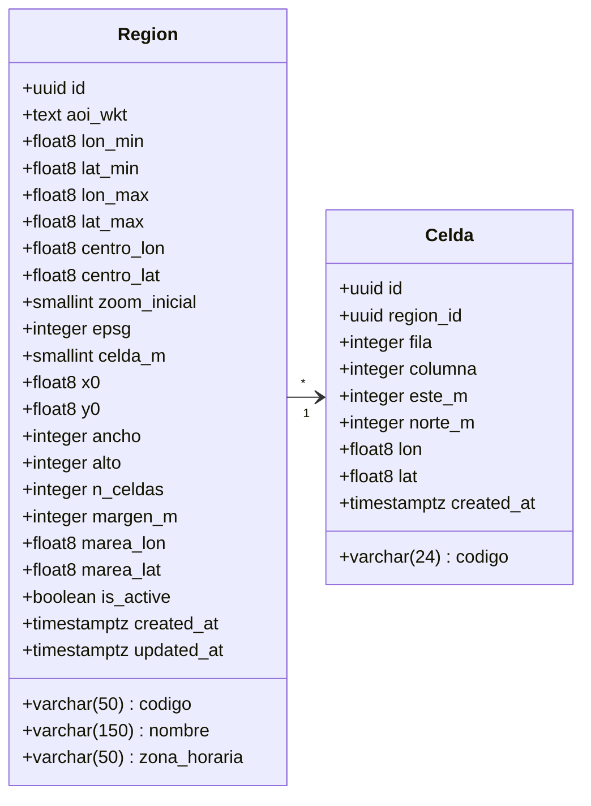

# Regiones

Dos tablas en la app `mangroove_regiones`: la región con su grilla y las celdas
que la componen.

La región es la única entidad cuya forma decide la de todas las demás: cada
recorte, cada grilla agregada y cada resultado se alinea con su grilla. Por eso
su grilla es inmutable desde la creación ([`RN-03`][rn-03]).

## Requerimientos cubiertos

- [`RF-O-02`][rf-o-02]
- [`RF-O-03`][rf-o-03]
- [`RF-C-01`][rf-c-01]
- [`RF-C-08`][rf-c-08]

## Diagrama



---

## `Region`

Un área de estudio con su polígono, su proyección y su grilla.

- **Régimen:** [Borrado lógico][regimenes]
- **Volumen estimado:** 1-5 filas
- **Origen:**
  > - [`RF-O-02`][rf-o-02]
  > - [`RN-03`][rn-03]

### Columnas

|           Campo            |      Tipo      | Nulo |   Predeterminado    |                     Descripción                     |
| :------------------------: | :------------: | :--: | :-----------------: | :-------------------------------------------------: |
|          `codigo`          | `varchar(50)`  |  no  |                     |    Identificador estable en rutas: `estero_real`    |
|          `nombre`          | `varchar(150)` |  no  |                     |                 Nombre para mostrar                 |
|         `aoi_wkt`          |     `text`     |  no  |                     |          Polígono del área en WKT, lon/lat          |
|   `lon_min` a `lat_max`    |    `float8`    |  no  |                     |         Caja envolvente del polígono, WGS84         |
| `centro_lon`, `centro_lat` |    `float8`    |  no  |                     |                 Donde abre el mapa                  |
|       `zoom_inicial`       |   `smallint`   |  no  |        `11`         |                Zoom inicial del mapa                |
|       `zona_horaria`       | `varchar(50)`  |  no  | `'America/Managua'` | Zona IANA para fechas locales, por [`RN-18`][rn-18] |
|           `epsg`           |   `integer`    |  no  |                     |               Zona UTM del centroide                |
|         `celda_m`          |   `smallint`   |  no  |        `100`        |             Lado de la celda en metros              |
|         `x0`, `y0`         |    `float8`    |  no  |                     | Esquina superior izquierda de la grilla, en metros  |
|      `ancho`, `alto`       |   `integer`    |  no  |                     |            Columnas y filas de la grilla            |
|         `n_celdas`         |   `integer`    |  no  |      generada       |           **Almacenada**. `ancho * alto`            |
|         `margen_m`         |   `integer`    |  no  |       `2000`        |      Margen alrededor del polígono al recortar      |
|  `marea_lon`, `marea_lat`  |    `float8`    |  no  |                     |       Punto en agua donde se estima la marea        |

### Constraints

```postgresql
CONSTRAINT chk_region_codigo
CHECK (codigo ~ '^[a-z][a-z0-9_]*$')

CONSTRAINT chk_region_caja
CHECK (
  lon_min BETWEEN -180 AND 180 AND lon_max BETWEEN -180 AND 180
  AND lat_min BETWEEN -90 AND 90 AND lat_max BETWEEN -90 AND 90
  AND lon_min < lon_max AND lat_min < lat_max
)

CONSTRAINT chk_region_epsg_utm
CHECK (epsg BETWEEN 32601 AND 32660 OR epsg BETWEEN 32701 AND 32760)

CONSTRAINT chk_region_celda
CHECK (celda_m BETWEEN 10 AND 1000)

CONSTRAINT chk_region_tamano
CHECK (ancho > 0 AND alto > 0 AND ancho::bigint * alto <= 1000000)

CONSTRAINT chk_region_zoom
CHECK (zoom_inicial BETWEEN 0 AND 22)
```

|       Nombre        | Definición |
| :-----------------: | :--------: |
| `unq_region_codigo` | `(codigo)` |

### Triggers

|        Nombre         |                         Evento                         | Momento  | Nivel |                 Regla                 |      Origen      |
| :-------------------: | :----------------------------------------------------: | :------: | :---: | :-----------------------------------: | :--------------: |
| `trg_readonly_grilla` | `UPDATE OF epsg, celda_m, x0, y0, ancho, alto, codigo` | `BEFORE` | `ROW` | Rechaza cualquier cambio de la grilla | [`RN-03`][rn-03] |

### Cálculo de la grilla

Al crear la región, el servicio proyecta la caja envolvente al EPSG del
centroide y fija:

- `x0 = floor(min(E) / celda_m) * celda_m`
- `y0 = ceil(max(N) / celda_m) * celda_m`
- `ancho = ceil((max(E) - x0) / celda_m)`
- `alto = ceil((y0 - min(N)) / celda_m)`

El origen queda alineado a múltiplos del tamaño de celda, así que dos regiones
con el mismo EPSG y el mismo tamaño de celda comparten bordes de celda donde se
solapan.

---

## `Celda`

Un cuadro de la grilla. Solo geometría: la máscara, el humedal y el país
dependen de los insumos y viven en los resultados de cada corrida
([`D-10`][d-10]).

- **Régimen:** [Solo inserción][regimenes]
- **Volumen estimado:** hasta 1 M por región
- **Origen:**
  > - [`RN-04`][rn-04]
  > - [`RF-C-08`][rf-c-08]

### Columnas

|    Campo     |     Tipo      | Nulo | Predeterminado |                       Descripción                        |
| :----------: | :-----------: | :--: | :------------: | :------------------------------------------------------: |
| `region_id`  |    `uuid`     |  no  |                |                                                          |
|    `fila`    |   `integer`   |  no  |                |                 Desde 0, de norte a sur                  |
|  `columna`   |   `integer`   |  no  |                |                 Desde 0, de oeste a este                 |
|   `este_m`   |   `integer`   |  no  |    derivada    |       Coordenada E del centro; la fija el trigger        |
|  `norte_m`   |   `integer`   |  no  |    derivada    |       Coordenada N del centro; la fija el trigger        |
|   `codigo`   | `varchar(24)` |  no  |    generada    | **Almacenada**. `'c_' \|\| este_m \|\| '_' \|\| norte_m` |
| `lon`, `lat` |   `float8`    |  no  |                |  Centro en WGS84, calculado con `pyproj` en el servicio  |

### Unicidad

|             Nombre              |          Definición          |
| :-----------------------------: | :--------------------------: |
| `unq_celda_region_fila_columna` | `(region_id, fila, columna)` |
|    `unq_celda_region_codigo`    |    `(region_id, codigo)`     |

### Triggers

|           Nombre           |  Evento  | Momento  | Nivel |                                                 Regla                                                 |      Origen      |
| :------------------------: | :------: | :------: | :---: | :---------------------------------------------------------------------------------------------------: | :--------------: |
| `trg_celda_derivar_centro` | `INSERT` | `BEFORE` | `ROW` | Sobrescribe `este_m` y `norte_m` con `x0 + (columna + 0,5) · celda_m` y `y0 − (fila + 0,5) · celda_m` | [`RN-04`][rn-04] |
| `trg_celda_dentro_grilla`  | `INSERT` | `BEFORE` | `ROW` |                          Rechaza filas o columnas fuera de `alto` y `ancho`                           | [`RN-03`][rn-03] |

### Ubicar una celda desde un punto

[`RF-C-08`][rf-c-08] no consulta esta tabla para encontrar la celda: proyecta el
punto al EPSG de la región y calcula
`columna = floor((E − x0) / celda_m)` y `fila = floor((y0 − N) / celda_m)`. La
tabla solo se lee después, por `unq_celda_region_fila_columna`, para unirla con
su resultado. Un punto sobre el borde exacto entre dos celdas cae siempre en la
de mayor columna y mayor fila, porque `floor` es determinista.

[d-10]: ../decisiones.md#d-10
[regimenes]: ../convenciones.md#regimenes-de-escritura
[rf-c-01]: ../../requerimientos/funcionales/consulta.md#rf-c-01
[rf-c-08]: ../../requerimientos/funcionales/consulta.md#rf-c-08
[rf-o-02]: ../../requerimientos/funcionales/operacion.md#rf-o-02
[rf-o-03]: ../../requerimientos/funcionales/operacion.md#rf-o-03
[rn-03]: ../../requerimientos/reglas-negocio.md#rn-03
[rn-04]: ../../requerimientos/reglas-negocio.md#rn-04
[rn-18]: ../../requerimientos/reglas-negocio.md#rn-18
